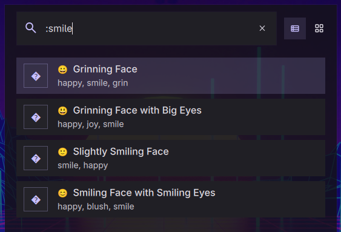

# Emoji & Unicode Launcher

A DankMaterialShell launcher plugin that provides quick access to thousands of emojis, mathematical symbols, and Nerd Font glyphs with instant clipboard copying.

Recently used characters are stored in DMS's plugin state file, keeping `plugin_settings.json` unchanged when selecting characters. Existing recents are copied from settings once; the legacy setting is left untouched so migration also works with read-only Nix-managed configuration. An intentionally empty state value takes precedence over legacy recents.



## Features

- **Expanded Emoji Catalog** - 900+ curated emoji entries combined with the bundled emoji dataset for complete coverage (gear, toolbox, etc.)
- **Latin Extended Characters** - 219 accented Latin characters covering Spanish (ñ, á, é), French (à, è, ç), German (ä, ö, ü), Portuguese, Nordic, Polish, Czech, and more
- **Unicode & Math Symbols** - Hundreds of useful unicode characters from arrows to operators and currency signs
- **Nerd Font Glyphs** - Searchable Nerd Font icons for launcher, terminal, and code workflows
- **Instant Copy** - One-click copy to clipboard with visual confirmation
- **Smart Search** - Search by name, character, or keywords with tokenized multi-word matching (for example: `french e`, `latin tilde n`)
- **Fast Empty Searches** - Blank or whitespace-only input reuses a bounded 50-item list, preserving recent-character and preferred-skin-tone ordering
- **Configurable Trigger** - Default `:e` or set your own trigger
- **Toast Notifications** - Visual feedback for every action

## Installation

For development, `node --test tests/empty-query.test.cjs` runs isolated Quickshell checks against the bundled catalog, including ranking, settings changes, cache invalidation, and bounded work for empty searches. It does not touch the clipboard or reload DMS.

Run `node --test tests/*.test.cjs` to include read-only migration and empty-state regression checks. The Quickshell test uses a result file to confirm completion independently of console logging.

### From Plugin Registry (Recommended)
```bash
dms plugins install emojiLauncher
```

### Manual Installation
```bash
# Copy plugin to DMS plugins directory
cp -r EmojiLauncher ~/.config/DankMaterialShell/plugins/

# Enable in DMS
# 1. Open Settings (Ctrl+,)
# 2. Go to Plugins tab
# 3. Click "Scan for Plugins"
# 4. Toggle "Emoji & Unicode Launcher" to enable
```

## Usage

### Default Trigger Mode
Note: Avoid triggers reserved by DMS or other plugins (e.g., `/` is used for file search).

1. Open launcher (Ctrl+Space)
2. Type `:e` followed by search query
3. Examples:
   - `:e smile` - Find smiling emojis
   - `:e heart` - Find heart emojis
   - `:e copyright` - Find © symbol
   - `:e arrow` - Find arrow characters
   - `:e tilde` - Find ñ, Ñ, and other tilde characters
   - `:e french e` - Find French accented e variants near the top
   - `:e latin tilde n` - Find ñ / Ñ near the top
4. Select item and press Enter to copy

## Search Examples

**Emojis:**
- `smile` → 😀 😃 😄 😁 😊
- `heart` → ❤️ 🧡 💛 💚 💙 💜
- `fire` → 🔥
- `star` → ⭐ ✨ 🌟

**Unicode Characters:**
- `copyright` → ©
- `trademark` → ™
- `degree` → °
- `pi` → π
- `arrow` → → ← ↑ ↓
- `infinity` → ∞
- `euro` → €

## Configuration

Access settings via DMS Settings → Plugins → Emoji & Unicode Launcher:

- **Trigger**: Set custom trigger character (`:e`, `:`, `;`, `em`, etc.)
  - Avoid triggers reserved by DMS or other plugins (e.g., `/` is used for file search).
- **Paste on Select**: Type selected character directly via `wtype` after copy
- **Clipboard Backend**: Prefer `dms cl copy` with `wl-copy` fallback

## Character Database

### Data Sources
- `data/emojis.txt` — comprehensive emoji list (Terminal Root)
- `data/latin-extended.txt` — accented Latin characters for multiple languages
- `data/math.txt` — math and general-purpose unicode symbols
- `data/nerdfont.txt` — curated Nerd Font glyph export

All files ship with the plugin, so search works fully offline.

### Highlights
- **Emoji coverage:** faces, hands, tools, activities, symbols, and flags (including gear ⚙️ and toolbox 🧰)
- **Latin extended:** accented characters for Spanish, French, German, Portuguese, Nordic, Polish, Czech, Romanian, Hungarian, Turkish, Vietnamese, and more
- **Unicode symbols:** math operators, arrows, currency, Greek letters, quotes, and miscellaneous symbols
- **Nerd Font glyphs:** VS Code Codicons, Powerline (ple-) separators, development icons, and other monospace-friendly glyphs for terminal/theming

### Updating the catalog
1. Modify the plain-text sources in `data/` (`emojis.txt`, `latin-extended.txt`, `math.txt`, `nerdfont.txt`).
2. Run `scripts/generate_catalog.py` to rebuild `catalog.js` (the file bundled with the plugin). The script parses the text files, normalizes names, and refreshes search keywords.

## Requirements

- DankMaterialShell >= 0.1.0
- `wl-copy` (from wl-clipboard package)
- Wayland compositor (Niri, Hyprland, etc.)

## Compatibility

- **Compositors**: Niri and Hyprland
- **Distros**: Universal - works on any Linux distribution

## Technical Details

- **Type**: Launcher plugin
- **Trigger**: `:e` (configurable)
- **Language**: QML (Qt Modeling Language)
- **Dependencies**: None (uses built-in character database)

## Contributing

Found a bug or want to add more characters? Open an issue or submit a pull request!

## Credits

Emoji database sourced from [Terminal Root's emoji collection](https://terminalroot.com/emojis.txt) - a comprehensive list of emojis with searchable names.

## License

MIT License - See LICENSE file for details

## Author

Created for the DankMaterialShell community

## Links

- [DankMaterialShell](https://github.com/AvengeMedia/DankMaterialShell)
- [Plugin Registry](https://github.com/AvengeMedia/dms-plugin-registry)
